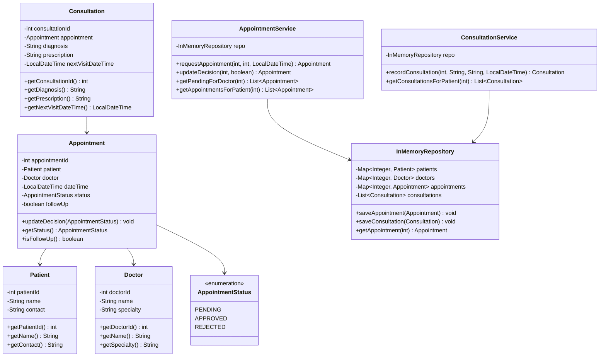
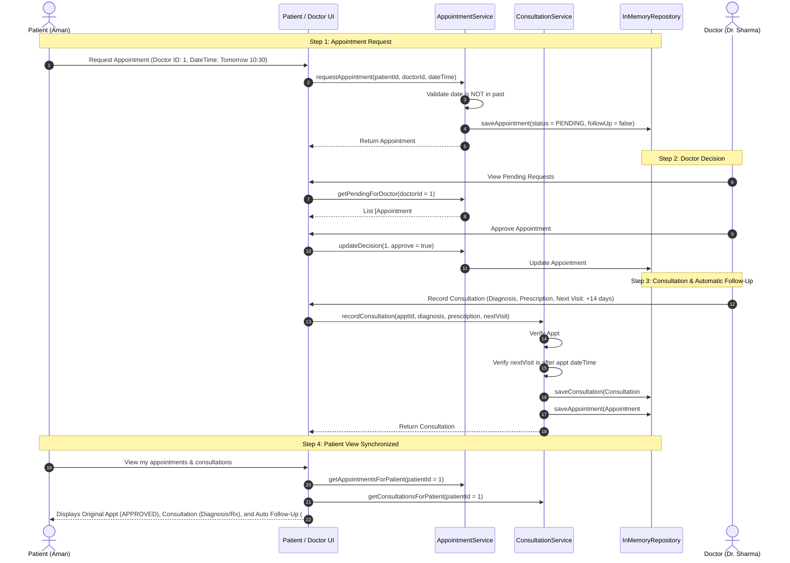

# Project Progress Report: Doctor Smart Appointment System

**Course:** Core Java / Object-Oriented Programming Laboratory  
**Project Title:** Doctor Smart Appointment System  
**Current Milestone:** Week 6–7 Progress Review (Core Workflow Complete & Verified)  
**Status:** 🟢 **On Track (Ahead of Schedule)**  

---

## 1. Executive Summary

The **Doctor Smart Appointment System** is a modular, layered Core Java application designed to coordinate the end-to-end appointment and consultation lifecycle between **Patients** and **Doctors**.

### Key Deliverables Completed:
- ✅ **Layered Architecture:** Clear separation between Presentation (`ui`), Business Logic (`service`), Data Access (`repository`), and Domain Entities (`model`).
- ✅ **Complete 4-Step Lifecycle:**
  1. **Request:** Patient requests an appointment with preferred date/time (initial status `PENDING`).
  2. **Review & Decision:** Doctor approves or rejects the request; patient view updates immediately.
  3. **Consultation Entry:** Doctor records clinical diagnosis and prescription for the approved visit.
  4. **Automatic Follow-Up Booking:** Doctor enters next-visit date/time, triggering automatic creation of a follow-up appointment with status `APPROVED`.
- ✅ **Domain Integrity & Custom Exceptions:** Robust input and state validation guards against invalid state transitions and invalid date scheduling.
- ✅ **Automated Testing Suite:** 10/10 automated tests passing (`SystemWorkflowTest.java`) with zero third-party dependencies.
- ✅ **1-Click Interactive Presentation Runner:** Built-in automated presentation mode (`DemoRunner.java` / `java -cp out Main --demo`) to showcase live execution to the evaluator.

---

## 2. System Architecture & Class Design

The project strictly follows the **Separation of Concerns** principle:

```
src/
├── Main.java               # Application bootstrap & interactive menu / demo trigger
├── DemoRunner.java         # Automated end-to-end presentation runner with colored telemetry
├── SystemWorkflowTest.java # 10-point unit & integration verification suite
├── model/                  # Domain entities & Enums
│   ├── Appointment.java
│   ├── AppointmentStatus.java (Enum: PENDING, APPROVED, REJECTED)
│   ├── Consultation.java
│   ├── Doctor.java
│   └── Patient.java
├── repository/             # In-memory data store using Java Collections
│   └── InMemoryRepository.java
├── service/                # Business logic & workflow rules
│   ├── AppointmentService.java
│   └── ConsultationService.java
├── ui/                     # Terminal user interface & input parsing
│   ├── DoctorMenu.java
│   ├── PatientMenu.java
│   └── InputHelper.java
└── exception/              # Custom runtime exception hierarchy
    ├── InvalidInputException.java
    ├── InvalidStateException.java
    └── NotFoundException.java
```

### UML Class Diagram



---

## 3. Workflow Sequence Diagram

The following sequence illustrates the complete end-to-end appointment lifecycle from request to auto-follow-up:



---

## 4. Core Java Concepts Demonstrated

| Core Java Concept | Implementation in Project | Code Reference |
|---|---|---|
| **Encapsulation** | Private fields, immutable identifiers (`final int appointmentId`), controlled mutations through guarded methods (`updateDecision`). | [`Appointment.java`](file:///Users/mohitsrivastav/Desktop/smart-appointment-system/Smart-Appointment-System/src/model/Appointment.java) |
| **Collections Framework** | `HashMap` for $O(1)$ patient/doctor lookups; `LinkedHashMap` for order-preserving appointment index; `ArrayList` for consultations and filtered queries. | [`InMemoryRepository.java`](file:///Users/mohitsrivastav/Desktop/smart-appointment-system/Smart-Appointment-System/src/repository/InMemoryRepository.java) |
| **Enums** | Strongly typed `AppointmentStatus` (PENDING, APPROVED, REJECTED) replacing magic strings and preventing illegal status assignments. | [`AppointmentStatus.java`](file:///Users/mohitsrivastav/Desktop/smart-appointment-system/Smart-Appointment-System/src/model/AppointmentStatus.java) |
| **Modern Date/Time API** | `java.time.LocalDateTime` and `DateTimeFormatter` (`dd-MM-yyyy HH:mm`) for robust time comparisons (`isBefore`, `isAfter`) without deprecated `java.util.Date`. | [`AppointmentService.java`](file:///Users/mohitsrivastav/Desktop/smart-appointment-system/Smart-Appointment-System/src/service/AppointmentService.java), [`InputHelper.java`](file:///Users/mohitsrivastav/Desktop/smart-appointment-system/Smart-Appointment-System/src/ui/InputHelper.java) |
| **Custom Exception Hierarchy** | Extends `RuntimeException` into distinct semantic types: `InvalidInputException` (validation), `InvalidStateException` (business rules), `NotFoundException` (entity lookup). | [`exception/`](file:///Users/mohitsrivastav/Desktop/smart-appointment-system/Smart-Appointment-System/src/exception) |
| **Separation of Concerns** | Isolated layers ensure business rules remain independent of console I/O; services can be reused by a web or GUI front-end without modification. | [`service/`](file:///Users/mohitsrivastav/Desktop/smart-appointment-system/Smart-Appointment-System/src/service) |

---

## 5. Verification & Testing Matrix

All 10 unit and integration tests execute successfully without third-party frameworks:

| Test ID | Test Scenario | Expected Outcome | Result |
|---|---|---|:---:|
| **TC-01** | Create appointment request | Status is `PENDING`, `isFollowUp == false` | ✅ **PASS** |
| **TC-02** | Schedule appointment in the past | Throws `InvalidInputException` | ✅ **PASS** |
| **TC-03** | Doctor approves pending request | Status updates to `APPROVED` | ✅ **PASS** |
| **TC-04** | Doctor rejects pending request | Status updates to `REJECTED` | ✅ **PASS** |
| **TC-05** | Attempt to re-decide non-pending appointment | Throws `InvalidStateException` | ✅ **PASS** |
| **TC-06** | Record consultation and verify auto follow-up | Creates Consultation + Follow-up with status `APPROVED` | ✅ **PASS** |
| **TC-07** | Attempt consultation on PENDING appointment | Throws `InvalidStateException` | ✅ **PASS** |
| **TC-08** | Attempt duplicate consultation on same appointment | Throws `InvalidStateException` | ✅ **PASS** |
| **TC-09** | Set next-visit date before appointment date | Throws `InvalidInputException` | ✅ **PASS** |
| **TC-10** | Verify patient data isolation & invalid ID checks | Throws `NotFoundException` for non-existent IDs | ✅ **PASS** |

---

## 6. How to Run the Demonstration

### 1. Run Automated Test Suite (Fast Verification)
```bash
javac -d out $(find src -name "*.java")
java -cp out SystemWorkflowTest
```

### 2. Run Presentation Walkthrough (For Teacher Demo)
```bash
java -cp out Main --demo
# OR
java -cp out DemoRunner
```

### 3. Run Interactive Console System
```bash
java -cp out Main
```
- Choose `1` to interact as Patient (Aman: ID 1, Riya: ID 2).
- Choose `2` to interact as Doctor (Dr. Sharma: ID 1).
- Choose `3` to trigger the automated walkthrough.

---

## 7. Viva / Evaluator Q&A Preparation

**Q1: Why did you use `LinkedHashMap` for appointments in `InMemoryRepository`?**  
> *Answer:* `LinkedHashMap` provides fast $O(1)$ key lookup by `appointmentId` while maintaining predictable insertion order, ensuring that appointment lists and queries display chronologically.

**Q2: How does the system guarantee that a follow-up appointment is not accidentally rejected?**  
> *Answer:* The follow-up appointment is instantiated by `ConsultationService` directly with `AppointmentStatus.APPROVED` and `followUp = true`, reflecting that it was scheduled by the medical doctor during consultation.

**Q3: How are invalid inputs like past dates handled?**  
> *Answer:* In `AppointmentService.requestAppointment()`, we check `dateTime.isBefore(LocalDateTime.now())` and immediately throw a custom `InvalidInputException`, which is caught by the UI layer to display a clean error message without crashing.

**Q4: Can a doctor record two consultations for the same visit?**  
> *Answer:* No, `ConsultationService.recordConsultation()` inspects existing consultations and throws `InvalidStateException("Consultation already recorded for this appointment")`.
