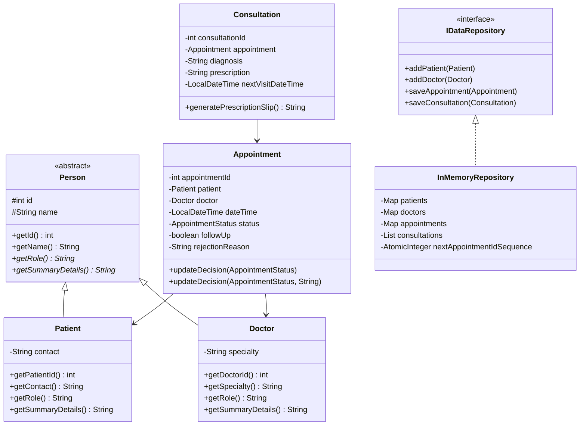

# Comprehensive Project Progress Report: Doctor Smart Appointment System

**Course:** Core Java / Object-Oriented Programming Laboratory  
**Project Title:** Doctor Smart Appointment & Clinical Workflow System  
**Current Milestone:** Week 8 Final Laboratory Evaluation (100% Complete & Verified)  
**Status:** 🟢 **Production & Evaluation Ready (16/16 Automated Tests Passing)**  
**Authors:**
- **Member 1:** Mohit Srivastav (Roll/ID: Member 1) — Patient Domain, Patient Portal UI, Interactive Web Presentation Simulator
- **Member 2:** Shreyas Tiwari (Roll/ID: Member 2) — Doctor Domain, Clinical Analytics, Follow-up Automation, File Persistence Engine & Rx Generation

---

## 1. Executive Summary

The **Doctor Smart Appointment System** is an enterprise-pattern Core Java application designed to coordinate the end-to-end appointment, clinical decision, and consultation lifecycle between **Patients** and **Medical Practitioners**.

### Key Deliverables Completed:
- ✅ **Polymorphic Domain Architecture:** Abstract base class `Person` extended by specialized actors `Patient` and `Doctor` featuring dynamic method dispatch.
- ✅ **Interface-Driven Design (SOLID / DIP):** Data access decoupled via `IDataRepository`, ensuring services depend strictly on storage abstractions.
- ✅ **Complete 5-Step Clinical Lifecycle:**
  1. **Request:** Patient requests an appointment with preferred date/time (initial status `PENDING`).
  2. **Review & Decision:** Doctor approves or rejects the request (with documented clinical audit reasons).
  3. **Consultation Entry:** Doctor records clinical diagnosis and prescription for the approved visit.
  4. **Automatic Follow-Up Booking:** Doctor enters next-visit date/time, triggering automatic creation of a follow-up appointment with status `APPROVED`.
  5. **Digital Prescription Slip & Persistence:** Generates official formatted Rx slips and snapshots system state to local disk.
- ✅ **Thread-Safety & Concurrency Hardening:** Lock-free sequence generation via `AtomicInteger` and thread-safe collections (`ConcurrentHashMap`, synchronized map wrappers).
- ✅ **Zero-Dependency File Persistence:** Automated snapshot export and graceful state preservation via a JVM shutdown hook (`FilePersistenceService.java`).
- ✅ **Automated Testing Suite:** 16/16 automated unit, integration, and concurrency tests passing (`SystemWorkflowTest.java`) with zero third-party dependencies.
- ✅ **1-Click Interactive Presentation Runner:** Built-in automated presentation mode (`DemoRunner.java` / `java -cp out Main --demo`) demonstrating all 8 clinical workflow stages.
- ✅ **Interactive Visual Web Dashboard:** Standalone presentation simulator (`web/index.html`) featuring live state visualization, architecture diagrams, and test runner.

---

## 2. System Architecture & Class Design

The project strictly adheres to the **Separation of Concerns (SoC)** and **Layered Architecture** principles:

```
src/
├── Main.java                        # System bootstrap, CLI routing & JVM shutdown hook
├── DemoRunner.java                  # Automated 8-stage live evaluator presentation walkthrough
├── SystemWorkflowTest.java          # 16-point unit, integration & concurrency verification suite
├── model/                           # Domain Entities, DTOs & Enums
│   ├── Person.java                  # Abstract base class (Abstraction & Inheritance)
│   ├── Patient.java                 # Patient entity (Inherits Person)
│   ├── Doctor.java                  # Doctor entity (Inherits Person)
│   ├── Appointment.java             # Scheduling entity & status transition guards
│   ├── AppointmentStatus.java       # Strongly typed Enum (PENDING, APPROVED, REJECTED)
│   ├── Consultation.java            # Clinical notes & digital Rx slip generator
│   └── DoctorStats.java             # DTO aggregating practitioner analytics
├── repository/                      # Data Access Layer & Storage Engines
│   ├── IDataRepository.java         # DAO interface abstraction (Dependency Inversion Principle)
│   ├── InMemoryRepository.java      # Thread-safe repository (ConcurrentHashMap, AtomicInteger)
│   └── FilePersistenceService.java  # Zero-dependency file persistence & audit logger
├── service/                         # Business Logic & Clinical Validation
│   ├── AppointmentService.java      # Queue management, decisioning & doctor analytics
│   └── ConsultationService.java     # Clinical consultation recording & follow-up generator
└── ui/                              # Presentation Layer (Console CLI)
    ├── PatientMenu.java             # Patient portal & prescription download
    ├── DoctorMenu.java              # Doctor workspace, analytics & decisioning
    └── InputHelper.java             # Date parsing, input sanitation & exception wrappers
```

### UML Class Hierarchy & Domain Interaction



---

## 3. Team Member Division & Responsibilities

| Contributor | Role & Package Responsibility | Concrete Modules Implemented |
|---|---|---|
| **Mohit Srivastav** | **Member 1 (Patient Portal & Presentation)** | - `Patient.java` entity model.<br>- `PatientMenu.java` interactive patient CLI.<br>- `web/` HTML5/CSS3/JS interactive evaluation simulator.<br>- Presets and patient date/time input validation. |
| **Shreyas Tiwari** | **Member 2 (Doctor Engine & Persistence)** | - `Doctor.java`, `Appointment.java`, `Consultation.java` domain models.<br>- `DoctorMenu.java` practitioner workspace.<br>- `DoctorStats.java` clinical performance analytics.<br>- Automatic follow-up appointment generation engine.<br>- `FilePersistenceService.java` local persistence & digital Rx slip exporter. |
| **Collaborative** | **Architecture & Quality Assurance** | - `Person.java` abstract base class.<br>- `IDataRepository.java` DAO interface abstraction.<br>- `SystemWorkflowTest.java` 16-point automated test suite.<br>- Concurrency hardening and evaluation defense documentation. |

---

## 4. Core Java & Object-Oriented Principles Demonstrated

| Core Java Principle | Implementation Mechanism | Direct Code Reference |
|---|---|---|
| **Abstraction & Inheritance** | Abstract base class `Person` provides common identity and defines abstract contracts overridden by `Patient` and `Doctor`. | [`src/model/Person.java`](src/model/Person.java), [`src/model/Doctor.java`](src/model/Doctor.java) |
| **Dynamic Polymorphism** | Polymorphic method dispatch via `person.getRole()` and `person.getSummaryDetails()`. | [`src/model/Patient.java`](src/model/Patient.java), [`src/model/Doctor.java`](src/model/Doctor.java) |
| **Encapsulation & Immutability** | Private fields, final identifiers (`final int appointmentId`), and guarded state mutations (`updateDecision`). | [`src/model/Appointment.java`](src/model/Appointment.java) |
| **Interface-Driven Design (DIP)** | High-level services depend on `IDataRepository` interface rather than concrete in-memory or database classes. | [`src/repository/IDataRepository.java`](src/repository/IDataRepository.java), [`src/service/AppointmentService.java`](src/service/AppointmentService.java) |
| **Collections Framework** | `ConcurrentHashMap` for $O(1)$ lookups, `LinkedHashMap` for order preservation, `ArrayList` for dynamic filtering. | [`src/repository/InMemoryRepository.java`](src/repository/InMemoryRepository.java) |
| **Thread-Safety & Concurrency** | Lock-free primary key generation using `AtomicInteger` and thread-safe synchronized collections. | [`src/repository/InMemoryRepository.java`](src/repository/InMemoryRepository.java) |
| **Modern Date/Time API** | `java.time.LocalDateTime` and `DateTimeFormatter` (`dd-MM-yyyy HH:mm`) for robust chronological comparisons. | [`src/service/AppointmentService.java`](src/service/AppointmentService.java), [`src/ui/InputHelper.java`](src/ui/InputHelper.java) |
| **File I/O & Persistence** | Zero-dependency file persistence using `PrintWriter`, `FileWriter`, and `Files.createDirectories`. | [`src/repository/FilePersistenceService.java`](src/repository/FilePersistenceService.java) |
| **JVM Shutdown Hook** | Registered hook on `Runtime.getRuntime().addShutdownHook(...)` snapshots database automatically upon program termination. | [`src/Main.java`](src/Main.java) |
| **Custom Exception Hierarchy** | Semantic exceptions extending `RuntimeException`: `InvalidInputException`, `InvalidStateException`, `NotFoundException`. | [`src/exception/`](src/exception/) |

---

## 5. Automated Verification & Testing Matrix (16/16 PASS)

Every unit, integration, and security guard test executes without third-party frameworks:

| Test ID | Test Scenario | Verified Rule & Invariant | Result |
|---|---|---|:---:|
| **TC-01** | Create appointment request | Initial status is `PENDING`, `isFollowUp == false` | ✅ **PASS** |
| **TC-02** | Schedule appointment in the past | Throws `InvalidInputException` ("cannot be in the past") | ✅ **PASS** |
| **TC-03** | Doctor approves pending request | Status updates cleanly to `APPROVED` | ✅ **PASS** |
| **TC-04** | Doctor rejects pending request | Status updates cleanly to `REJECTED` | ✅ **PASS** |
| **TC-05** | Attempt to re-decide decided appointment | Guard prevents state mutation; throws `InvalidStateException` | ✅ **PASS** |
| **TC-06** | Record consultation & auto follow-up | Creates Consultation + Follow-up with status `APPROVED` | ✅ **PASS** |
| **TC-07** | Attempt consultation on PENDING visit | Throws `InvalidStateException` ("only for APPROVED appointment") | ✅ **PASS** |
| **TC-08** | Attempt duplicate consultation on same visit | Throws `InvalidStateException` ("already recorded") | ✅ **PASS** |
| **TC-09** | Set next-visit date before appointment date | Throws `InvalidInputException` ("must be after current appointment") | ✅ **PASS** |
| **TC-10** | Verify patient data isolation & invalid ID checks | Throws `NotFoundException` for unmapped patient/doctor IDs | ✅ **PASS** |
| **TC-11** | Doctor clinical analytics calculation | Aggregates approval %, completed consults, and follow-ups | ✅ **PASS** |
| **TC-12** | Doctor consultation history isolation | Restricts consultation query results to calling doctor | ✅ **PASS** |
| **TC-13** | Rejection with clinical audit reason | Captures and persists clinical justification for rejection | ✅ **PASS** |
| **TC-14** | Polymorphic `Person` abstraction checks | Verifies dynamic dispatch of `getRole()` and `getSummaryDetails()` | ✅ **PASS** |
| **TC-15** | Digital prescription slip export & file generation | Generates formatted Rx slip and saves to `records/prescriptions/` | ✅ **PASS** |
| **TC-16** | Concurrency & Atomic sequence ID verification | 500 concurrent appointment creations with zero ID collisions | ✅ **PASS** |

---

## 6. How to Run the Demonstration

### 1. Run Automated Test Suite (Fast 16-Point Verification)
```bash
javac -d out src/exception/*.java src/model/*.java src/repository/*.java src/service/*.java src/ui/*.java src/*.java
java -cp out SystemWorkflowTest
```

### 2. Run Presentation Walkthrough (For Teacher Demo)
```bash
java -cp out Main --demo
# OR
java -cp out DemoRunner
```

### 3. Run Interactive Console System
```bash
java -cp out Main
```
- Option `1`: Patient Portal (Member 1).
- Option `2`: Doctor Workspace & Analytics (Member 2).
- Option `3`: Automated Presentation Walkthrough.
- Option `4`: Export System Diagnostic Database Snapshot.

---

## 7. Viva / Evaluator Q&A Preparation Summary

*(For exhaustive 1-hour viva preparation, refer to [docs/VIVA_PREPARATION_GUIDE.md](VIVA_PREPARATION_GUIDE.md))*

**Q1: Why did you use `LinkedHashMap` for appointments in `InMemoryRepository`?**  
> *Answer:* `LinkedHashMap` provides fast $O(1)$ key lookup by `appointmentId` while maintaining predictable chronological insertion order, ensuring appointment queues display in the exact sequence they were submitted.

**Q2: How does the system guarantee that a follow-up appointment is not accidentally rejected?**  
> *Answer:* The follow-up appointment is instantiated by `ConsultationService` directly with `AppointmentStatus.APPROVED` and `followUp = true`, reflecting that it was scheduled by the medical doctor during consultation.

**Q3: How is data preserved without a heavy SQL database?**  
> *Answer:* We engineered `FilePersistenceService` and hooked it into the JVM lifecycle via `Runtime.getRuntime().addShutdownHook(...)`. On shutdown, it serializes entities to `records/database_snapshot.txt` and outputs printable prescription files without external database overhead.

**Q4: How did you ensure thread-safety during concurrent bookings?**  
> *Answer:* We replaced standard integer sequence counters with `AtomicInteger` for lock-free sequence increments and utilized `ConcurrentHashMap` combined with thread-synchronized collection wrappers to eliminate race conditions.
